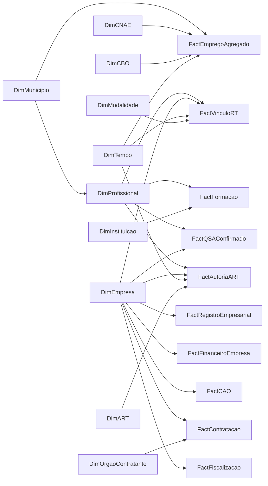

> **Arquivo histórico — substituído pela diretriz V7.** O conteúdo abaixo preserva decisões e evidências das versões anteriores; não descreve as fontes ativas do BI. A V7 exclui fatos capturados manualmente de sites, PDFs e snapshots dessas medidas. Em produção, o relatório deve consumir SQL Server/DB2 pelo gateway ou APIs homologadas, com rotina automática de ingestão; arquivos oficiais podem alimentar o banco por ETL homologado. Consulte [ATUALIZACAO_AUTOMATICA_V7.md](ATUALIZACAO_AUTOMATICA_V7.md). A integração institucional ainda precisa ser configurada e validada.

# Arquitetura analítica CREA-SP — empresas e profissionais

Versão do protótipo: 4.0. Os fatos exibidos são demonstrativos, gerados com a semente `20260930`; a competência é `30/09/2026` e a atualização do cenário é `30/09/2026` (a importação dos anexos foi registrada em 09/10/2026). A arquitetura propõe um relatório para computador no Power BI. Ela não pressupõe acesso às bases internas, nem transforma o protótipo React em um arquivo `.pbix` automaticamente.

## Seis domínios, um modelo semântico

| Domínio | Pergunta que organiza a página | Conteúdo |
| --- | --- | --- |
| Visão geral | Como o conjunto evolui e se distribui? | Evolução, território e indicadores agregados de empresas, profissionais e mercado. |
| Empresas | Qual é a estrutura da base empresarial? | Cadastro, movimentação, perfil, qualidade, financeiro e acervo operacional da pessoa jurídica. |
| Profissionais | Quem compõe o universo profissional e como se relaciona com as empresas? | Cadastro profissional, modalidades, ingresso, formação, domicílio, RT, autoria de ART e participação societária confirmada. |
| Mercado e emprego | Como a atividade econômica e o emprego formal evoluem no território? | CNAEs, composição setorial, emprego agregado por município/CNAE/CBO/mês e conciliação cadastral descritiva. |
| Contratações | Como os fornecedores e objetos de engenharia participam das compras públicas? | PNCP, valores contratados, categorias publicadas e concentração de fornecedores. |
| Fiscalização | Quais conjuntos exigem verificação e qual é o andamento das análises? | Alertas de verificação, priorização, divergências utilizadas na triagem, casos, encaminhamentos, autos, classificação de objetos e resultados. |

As páginas não representam superintendências isoladas. O mesmo modelo serve a diferentes áreas, respeitando acesso, competência, unidade de contagem e fonte de cada medida. Os detalhes de uma empresa ou de um profissional são recursos de investigação do recorte; não são a finalidade principal do relatório.

**Fiscalização é um domínio exclusivo.** Pontuação, indicação de possível ausência cadastral para verificação, fila de triagem, ausência de RT usada como motivo de análise, autuações e alertas de fiscalização ficam nessa página. Fora dela, relações técnicas e correspondência entre fontes são descrições da base, sem rótulos de irregularidade. Um sócio não é automaticamente RT; um CNAE não determina obrigação de registro; ausência de correspondência não prova infração.

## Entidades e granularidade

O enriquecimento profissional fica em `src/domain/professionals.ts`, separado do `Dataset` empresarial anteriormente validado. Ele referencia os mesmos identificadores existentes e não modifica as contagens ou o fluxo aleatório original.

| Relação demonstrativa | Volume | Grão / chave | Semântica |
| --- | ---: | --- | --- |
| Perfil profissional | 600 | Uma pessoa por `professionalId` | Registro demonstrativo, título, modalidade, data de ingresso, status atual e domicílio. Inclui pessoas sem empresa ou RT. |
| Formação | 720 | Uma formação por `educationId` | Graduação ou especialização fictícia. Segurança do trabalho possui graduação e especialização; não é tratada como graduação isolada. |
| QSA de origem | 210 | Uma participação candidata por `qsaId` | 100 confirmadas por chave interna fictícia, 50 sugestões nominais e 60 sem correspondência. |
| Autoria de ART | 271 | Um autor sintético declarado por `artId` na demonstração | Ponte com profissional e empresa existentes. Não força autoria para as demais ARTs. Em produção, a fonte pode permitir múltiplos autores. |
| Vínculo RT existente | 1.500 | Um período de vínculo por `technicalLinkId` | Pessoa → empresa → modalidade → início/fim. Existem 814 vínculos vigentes na competência. |
| Emprego agregado existente | 51.840 | Município × CNAE × CBO × mês | Estoque, admissões e desligamentos. Não contém `professionalId` nem `companyId`. |

No universo completo, os 600 perfis reconciliam em **492 ativos + 75 interrompidos + 33 cancelados**. Há **240 profissionais distintos com RT vigente**, associados a **664 empresas distintas** por **814 vínculos vigentes**. Os outros 360 profissionais permanecem no universo; ausência de vínculo empresarial não constitui irregularidade. Desses 600, 200 nunca aparecem em qualquer vínculo RT da amostra histórica.

O modelo contém 271 ARTs com autoria declarada em toda a história; a janela de 12 meses contém 183. A cobertura parcial é deliberada. ARTs sem autor simulado não recebem um autor fabricado apenas para completar gráficos.

## Modelo de relacionamentos para Power BI

O diagrama apresenta a separação das entidades e dos grãos. As setas representam o sentido preferencial de filtro de dimensão para fato, não propagação bidirecional automática entre fatos.



Regras de implementação:

- Manter dimensões com chaves únicas e relações `1:N`, preferencialmente com direção única.
- Separar município do domicílio profissional, município do estabelecimento, local da contratação e território do emprego. Usar dimensões de município por papel, relações inativas ou medidas explícitas quando um único filtro sincronizado precisar atuar em vários papéis.
- Usar ponte Estabelecimento × CNAE para principal/secundários. Para o fluxo RT → CNAE, o protótipo escolhe somente o CNAE principal da matriz; a espessura conta vínculos, não pessoas únicas.
- QSA sugerido fica em uma tabela de conciliação para revisão. A relação analítica validada usa apenas `matchStatus = Confirmado por chave interna`; não criar relação ativa de identidade a partir de nome parecido.
- Manter `FactAutoriaART` independente de `FactVinculoRT`. O identificador de RT na amostra registra o critério de geração plausível, não autoriza inferir autoria de ART a partir do RT em produção.
- Manter ARTs, CAOs e a ponte CAO × ART em seus grãos originais. Evitar dois caminhos ativos de filtro da empresa até a mesma ponte. Medidas com `DISTINCTCOUNT` impedem somar a mesma ART várias vezes quando existir mais de um autor ou mais de uma CAO.
- Emprego agregado liga-se às dimensões Município, CNAE, CBO e Tempo. Não criar relação artificial entre essas linhas e CNPJ, profissional, sócio ou autor de ART.
- Não habilitar relações bidirecionais amplas para fazer a seleção de empresas chegar a profissionais. Aplicar os conjuntos de identidades confirmadas de forma explícita, por exemplo com `TREATAS`, e documentar que relação produziu o subconjunto.

## Fontes internas e externas: associações válidas

| Informação | Fonte pretendida | Associação permitida | Limitação |
| --- | --- | --- | --- |
| Cadastro profissional, título e situação | Cadastro interno CREA-SP / identificador profissional autorizado | Chave interna estável ou RNP validado, quando disponível e autorizado | Nome não basta; título cadastral não demonstra sozinho todas as atribuições legais individuais. |
| Formação individual | Cadastro de formação profissional interno validado | `professionalId` e código de curso/instituição | INEP agregado não comprova a formação de uma pessoa identificada. |
| Responsabilidade técnica | Vínculos internos com início, fim e modalidade | `professionalId` + `companyId` + período | Quantidade de vínculos é diferente de quantidade de profissionais ou empresas. |
| Autor de ART | Fonte interna de autoria de ART | `artId` + identificador de autor declarado | Ter vínculo RT com a empresa não demonstra que a pessoa assinou uma determinada ART. |
| CAO | Base interna de certidões operacionais | `companyId` + ponte CAO × ART | CAO pertence à pessoa jurídica; não equivale à CAT. |
| QSA | Receita Federal, conforme os campos e condições de acesso disponíveis | CNPJ para empresa; identidade pessoal somente por chave autorizada e validada | CPF mascarado e homônimos impedem conciliação pessoal determinística pública. Similaridade de nome é sugestão para revisão. |
| Mercado profissional | RAIS / Novo CAGED / CBO | Município × CNAE × CBO × competência | Ocupação declarada não comprova registro CREA nem autoria; não individualizar emprego ou salário. |
| Formação regional | INEP / Censo da Educação Superior | Curso/instituição/região/ano em agregações disponíveis | Não vincular alunos ou formados ficticiamente a perfis CREA reais. |
| Contratação pública | PNCP e fontes complementares | CNPJ do fornecedor, órgão, objeto, data e local disponíveis | Classificação de objeto não comprova obrigação de registro ou infração. |

O enriquecimento fictício não utiliza CPF, salário individual ou empregador declarado como dado pessoal externo. Quando a implantação real exigir identificadores pessoais, devem existir autorização, finalidade, proteção, trilha de processamento e revisão das chaves de identidade.

## Semântica dos filtros profissionais

O seletor `selectProfessionalScope` trabalha com regras explícitas:

1. Sem filtro empresarial, o denominador é todo o cadastro profissional da amostra, inclusive pessoas sem RT ou participação societária.
2. Município e GRE filtram o **domicílio do profissional**. A pessoa pode residir em uma cidade e possuir RT com empresa de outra cidade; a empresa não precisa coincidir com o domicílio.
3. CNAE, porte, situação Receita, situação do registro empresarial, pesquisa de empresa/CNPJ ou subconjunto empresarial restringem a população por **RT histórico/vigente ou QSA confirmado** nas empresas elegíveis. Sugestões de nomes não criam associação. O relatório informa esse novo denominador.
4. Modalidade, status cadastral profissional, pesquisa profissional e seleção de identidades são filtros próprios desse domínio. Status profissional não é convertido em situação da empresa.
5. Seleções de coorte, distribuição ou fluxo aplicam o conjunto de `professionalIds` a perfis, vínculos, QSA confirmado e ARTs declaradas, preservando suas unidades de contagem.
6. O emprego público continua sendo calculado por município/CNAE/CBO/período. Filtrar um profissional, empresa, status profissional ou vínculo não atribui essas observações agregadas à pessoa selecionada. Uma seleção CNAE pode alterar o agregado pela dimensão CNAE; isso não é uma relação pessoal de emprego.
7. A janela temporal limita ingressos, ARTs e fatos de fluxo. O status profissional e o vínculo vigente são estoques na competência. A coorte representa o ano de ingresso; sem fatos completos de mudança de status, ela não é uma análise de retenção ou evasão.

Na página de profissionais, o território de empresa e o território de emprego devem aparecer identificados quando forem apresentados ao lado do domicílio. Exportações registram a fonte demonstrativa e seguem a permissão do perfil. O protótipo não implementa segurança real de produção apenas por esconder controles: a implantação exigirá autenticação, RLS/OLS e proteção de dados na origem.

## Medidas profissionais propostas

Exemplos de DAX abaixo descrevem a regra analítica, não um modelo `.pbix` já entregue. Os nomes das tabelas podem ser adaptados, mas a unidade e o denominador devem permanecer explícitos.

```dax
Profissionais distintos =
DISTINCTCOUNT ( DimProfissional[professionalId] )

Profissionais ativos =
CALCULATE (
    [Profissionais distintos],
    DimProfissional[status] = "Ativo"
)

Vínculos RT vigentes =
VAR Competencia = MAX ( DimCompetencia[Data] )
RETURN
CALCULATE (
    COUNTROWS ( FactVinculoRT ),
    FILTER (
        FactVinculoRT,
        FactVinculoRT[startDate] <= Competencia
            && ( ISBLANK ( FactVinculoRT[endDate] )
                || FactVinculoRT[endDate] > Competencia )
    )
)

Profissionais com RT vigente =
VAR Competencia = MAX ( DimCompetencia[Data] )
RETURN
CALCULATE (
    DISTINCTCOUNT ( FactVinculoRT[professionalId] ),
    FILTER (
        FactVinculoRT,
        FactVinculoRT[startDate] <= Competencia
            && ( ISBLANK ( FactVinculoRT[endDate] )
                || FactVinculoRT[endDate] > Competencia )
    )
)

ARTs com autoria declarada =
DISTINCTCOUNT ( FactAutoriaART[artId] )

Autores de ART =
DISTINCTCOUNT ( FactAutoriaART[professionalId] )

Profissionais com QSA confirmado =
CALCULATE (
    DISTINCTCOUNT ( FactQSAOrigem[professionalId] ),
    FactQSAOrigem[matchStatus] = "Confirmado por chave interna"
)
```

`FactAutoriaART` recebe a data da ART para o filtro de período; em produção a dimensão de tempo deve usar uma relação de data explícita. A competência de estoque pode usar uma dimensão desconectada `DimCompetencia`, evitando que o filtro de mês elimine vínculos iniciados antes da janela e ainda vigentes. Se o mesmo calendário filtrar início do vínculo e data de competência, a medida deve remover esse filtro de início antes de avaliar a vigência, ou utilizar relações de tempo por papel.

A medida de cadastro profissional pode contar toda a dimensão. Ao selecionar empresas, construir o conjunto de `professionalId` dos RTs relevantes unido ao conjunto de QSA confirmado e aplicar `TREATAS` à dimensão profissional. Uma medida de sócios confirmados não inclui sugestões. Uma medida de autores de ART não usa o número de profissionais com RT, e uma medida de empresas com ART não usa o número de empresas com participação societária.

As sete unidades devem continuar distinguíveis: **profissional**, **registro profissional**, **formação**, **vínculo RT**, **empresa**, **ART** e **participação societária**. A demonstração tem um registro por perfil, mas isso não impõe que a base real nacional ou histórica tenha a mesma cardinalidade.

## Visualizações e preparação para o relatório

| Análise do protótipo | Power BI previsto | Regra importante |
| --- | --- | --- |
| Composição profissional por modalidade e status | Barras empilhadas / parâmetros de campo | Segmentos reconciliam no universo profissional selecionado. |
| Coorte de ingresso × modalidade | Matriz com formatação condicional | Cor representa quantidade, não retenção. |
| Número de empresas por profissional | Histograma por intervalos de medida | Empresas distintas por pessoa; incluir faixa sem vínculo. |
| Modalidade/título → CNAE das empresas | Matriz, árvore de decomposição ou Sankey customizado validado | Espessura conta vínculos; seleção retorna pessoas e empresas distintas. Sankey é extensão customizada, não visual nativo garantido. |
| Domicílio profissional × mercado agregado | Mapa e dispersão municipal | Relação territorial descritiva, sem concluir emprego individual ou causalidade. |
| Participação societária | Matriz ou visual de relações customizado validado | Apenas identidades confirmadas entram na rede analítica. |
| ARTs com autoria declarada | Séries, matrizes e página de drillthrough | Separar ART, autor e empresa; CAO não vira CAT. |
| Ficha profissional e empresa | Páginas de drillthrough com tooltips de relatório | Manter o recorte; abrir cadastro administrativo externo apenas como recurso complementar autorizado. |

## CAT e extensões futuras

**CAT não foi simulada.** Para integrar acervo técnico profissional, serão necessários dados próprios de CAT, situação da certidão, profissional titular, ARTs relacionadas e eventos de emissão/revogação. A CAO existente é operacional e empresarial. Não deduzir CAT a partir de CAO, modalidade ou vínculo RT.

O ingresso no cadastro, a conclusão de formação, o início de RT e o início de emprego são eventos diferentes. Uma evolução histórica de status profissional exige fatos de registro/interrupção/reativação/cancelamento reais, com data de validade. Estudos de remuneração ou desvalorização profissional exigem bases agregadas e métodos próprios, sem apresentar inferências fictícias sobre salários individuais.

Cada relação futura deve informar fonte, cobertura, data de competência, atualização, método de conciliação e grau de validação. Regras e fórmulas deste protótipo são propostas, não métricas oficiais ou interpretações jurídicas vinculantes do CREA-SP.

## Validação do enriquecimento

`tests/professionals.test.ts` valida reprodução por semente, preservação do dataset anterior, integridade referencial, conciliação de status, autores declarados e intervalos de RT usados na geração, inclusão de profissionais sem empresa, semântica do domicílio, associação por empresa/CNAE, exclusão de sugestões nominais da identidade confirmada, seleção de subconjuntos, independência do emprego agregado e exportação com permissão e proteção de fórmulas CSV.

O calendário de exportação deve cobrir o primeiro `registeredAt` profissional, além das datas empresariais e dos anos de formação; o CSV começa em 2006 para contemplar também a formação fictícia. O modelo de demonstração contém ingressos desde 2010; esses anos não devem desaparecer de uma dimensão de tempo iniciada apenas na série pública de emprego de outubro de 2023.

Referências públicas para as limitações de identidade: [metadados do CNPJ/QSA — Receita Federal](https://www.gov.br/receitafederal/dados/cnpj-metadados.pdf) e [microdados não identificados de RAIS/CAGED — MTE](https://www.gov.br/trabalho-e-emprego/pt-br/assuntos/estatisticas-trabalho/microdados-rais-e-caged). Nome e CPF descaracterizado não confirmam identidade profissional; as estatísticas públicas não atribuem trabalhador a RNP.
