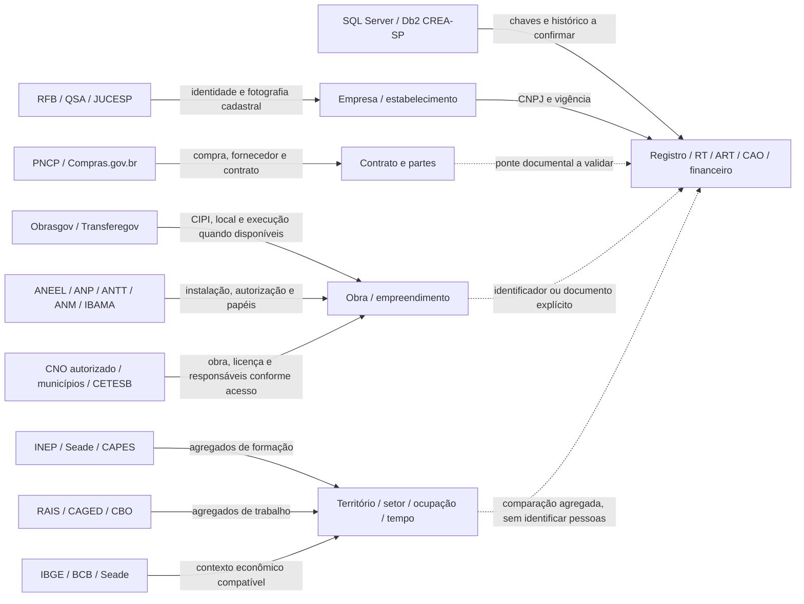
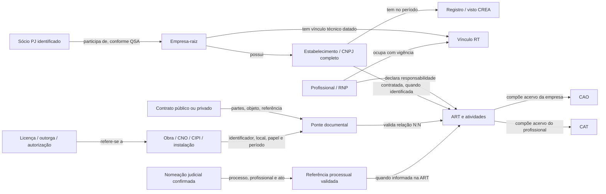
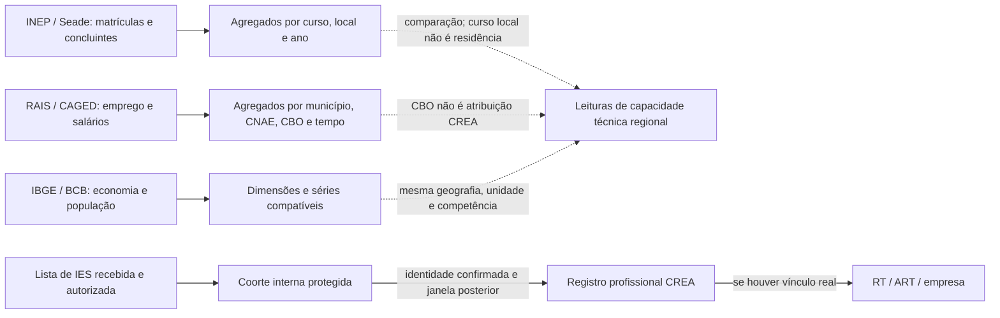

# Mapa de relações e cruzamentos propostos

**Planejamento, 29/10/2026. Os grafos abaixo descrevem tipos de relações possíveis; não representam uma rede de vínculos reais já construída.** A presença de uma ligação no desenho não significa acesso concedido, campo preenchido ou obrigação profissional comprovada.

## 1. Mapa das fontes para os domínios do CREA-SP

As setas contínuas significam uma família de informação documentada, não um vínculo já validado entre registros. As tracejadas destacam a condição adicional de correspondência documental ou comparação compatível.

## 2. Rede empresarial e documental

O vínculo RT não substitui a ART de uma atividade; uma ART pode ter diferentes partes e várias atividades. A ponte contrato–ART é muitos para muitos. Um empreendimento pode ter vários contratados e profissionais. A mesma ART inicial/complementar/substituta pode descrever o mesmo trabalho: contagem de documentos não é contagem de obras e seu valor não pode ser somado indiscriminadamente.

O RRT aparece no CNO como documento de outro conselho: serve para reconhecer outro sistema de responsabilidade, não para virar ART faltante. Profissional que faz perícia sem empresa deve permanecer no ramo profissional; o BI empresarial não pode inventar CNPJ para completar essa cadeia.

## 3. Contexto agregado e coortes autorizadas

As duas partes não se conectam por CPF público. Dados públicos de educação e emprego não autorizam concluir que uma pessoa se formou e foi contratada por uma empresa. A coorte nominal interna tem universo próprio e só produz taxa de ingresso para as listas efetivamente recebidas, deduplicadas e elegíveis.

## Matriz dos principais cruzamentos

| Cruzamento | Chave e condição | Informação resultante | O que não permite concluir |
|---|---|---|---|
| RFB × registro/visto CREA | CNPJ completo, raiz como consolidação separada; situações e datas | Correspondência exata no universo selecionado; divergências | Obrigação de registro ou infração apenas pelo CNAE |
| QSA PJ × RFB × CREA | CNPJ do sócio PJ e da empresa investida; papel e fotografia | Rede societária declarada e presença cadastral | Controle final, favorecimento ou identidade de PF por nome/CPF parcial |
| PNCP × CREA | Identificador do fornecedor e vigência na data escolhida | Fornecedores em contratos técnicos com registro/visto identificado | Que fornecedor sem correspondência esteja irregular |
| PNCP × ART | Contrato/compra, partes, objeto, local e referência validados | Rastreabilidade documental dos contratos | Vínculo confirmado por qualquer ART da empresa na mesma época |
| PNCP × Obrasgov | CIPI/identificadores/documentos presentes em ambas as fontes | Contrato associado a projeto e localização/execução | Cobertura universal da ponte ou obra executada só pela publicação |
| Obrasgov × ART | Projeto/contrato/obra e referências verificadas | Documentação técnica relacionada ao empreendimento | Ausência de responsabilidade só porque a ponte ainda não foi encontrada |
| CNO × ART | Campo ART com namespace/formato verificados; obra e responsável | Correspondência obra–documento; qualidade de preenchimento | Que responsável tributário seja RT ou executor; acesso público anônimo |
| Alvará/licença × ART | Processo, SQL/cadastro imobiliário ou referência oficial; geografia auxilia | Empreendimentos com documentação identificada | Correspondência determinística por endereço ou nome do interessado |
| ANEEL SIGA × agentes × CREA | CEG → agente/CNPJ; vigência/participações | Usinas e agentes com presença cadastral; expansão regional | Que agente seja projetista/instalador/RT |
| ANP × RFB × CREA | CNPJ do estabelecimento autorizado, local e data | Universo de instalações/operadores selecionados | Que autorização ANP implique a mesma obrigação em todos os casos |
| ANM × titulares × CREA | Processo + cadastro complementar identificado; camada sem CNPJ não basta | Empreendimentos minerários com titular confirmado | Mina em operação ou titular identificado apenas por nome |
| IBAMA/CETESB/ANA × CREA | CNPJ quando disponível; licença/outorga/empreendimento; papéis | Atividades e demandas técnicas específicas | Que todo licenciado seja prestador de serviço profissional |
| BNDES × RFB/CREA × PNCP | CNPJ/projeto/contrato/município, conforme recurso | Investimento apoiado e presença cadastral/técnica observável | Financiamento como receita, contrato público ou obra concluída |
| TCE despesa × contrato/fornecedor | Empenho/processo/contrato com ponte validada; de-para municipal | Valores publicados em etapas financeiras distintas | Parecer de regularidade do tribunal ou duplicar valores PNCP+empenho+pagamento |
| Nomeação judicial × ART | Processo CNJ, ato, identidade autorizada e especialidade | Nomeações técnicas com documentação identificada | Profissão do perito inferida pelo assunto ou que laudo demonstre necessidade legal do título |
| RT × ART × CAO | Relações internas com vigência e atividades | Continuidade técnica e acervo empresarial documentado | RT ativo sozinho provar cobertura de qualquer atividade |
| Emprego × cadastro/ART | Município×CNAE×tempo em nível compatível | Diferença de trajetórias setoriais e territoriais | Empregados nominais da empresa ou efeito causal da atuação do CREA |
| Formação × ingresso CREA | Agregado compatível; nominal apenas em coorte interna autorizada | Oferta regional e ingresso observado após conclusão | Todos os concluintes registrados ou taxa individual INEP sem identificação autorizada |
| Crédito/PIB/população × empresas | Dimensões/tempo e abrangência compatíveis | Contexto econômico e escalas territoriais | Crédito, faturamento ou produtividade de um CNPJ específico |
| Câmara/Senado/ALESP × setores | ID da proposição, assunto validado, vigência/etapa | Mudanças potenciais que afetam atividades/empresas | Norma aprovada só por projeto, relevância garantida por palavra-chave |

## Três categorias de arestas no modelo

1. **Documental confirmada:** a ligação entre dois registros foi comprovada por chave/documento e validada. Guardar fonte, identificador do registro de origem, evidência, papéis e intervalo de validade. A confirmação aplica-se à ligação específica, não à regularidade da entidade.
2. **Correspondência candidata:** proximidade de nome, objeto, endereço, local e tempo. Guardar critérios e alternativas. Não entra no numerador de vínculo comprovado. Pontuação de similaridade não é probabilidade de infração.
3. **Contexto agregado:** ligação à mesma dimensão/tempo, sem afirmar relação individual entre fatos. Exemplo: emprego CNAE×município ao lado de evolução de ARTs naquele recorte.

O desenho relacional mínimo de arestas pode ser `origem_tipo`, `origem_id`, `destino_tipo`, `destino_id`, `relacao`, `papel`, `fonte_id`, `registro_fonte_id`, `metodo`, `categoria_evidencia`, `valido_desde`, `valido_ate`, `observado_em`, `processado_em`, `regra_versao`, `validacao_status`. Ausência de fim de vigência deve permanecer desconhecida, não ser inventada. Dados pessoais ficam em camada restrita e não precisam aparecer no grafo publicado.

## Como explorar isso no Power BI

- **Barras/colunas combinadas e linha:** evolução de estabelecimentos elegíveis, registros e movimentos. Mostrar unidades e escalas independentes quando necessário, sem apresentar estoques e fluxos como somas equivalentes.
- **Matriz e pequenos múltiplos:** município/GRE×setor×evidência; comparações com a mesma população e competência.
- **Mapa bivariado ou dispersão:** intensidade econômica×cobertura; destacar somente onde ambos os denominadores têm cobertura suficiente. O mapa do fornecedor é diferente do mapa da obra.
- **Decomposição e drillthrough:** indicador → dimensão → conjunto → empresa/empreendimento → documento. O detalhamento é leitura, sem encaminhar/autuar no BI.
- **Sankey ou alluvial:** caminhos de entidades apenas com conservação de unidade. Uma empresa com vários contratos não deve ser contada como se cada aresta fosse uma nova empresa. Se visual externo não for homologado, usar barras ou matriz nativas.
- **Grafo de relações:** útil no detalhe de um conjunto pequeno; a base inteira como emaranhado de milhares de nós tende a atrapalhar. Manter lista e evidências acessíveis como alternativa. Exigir homologação do visual customizado e seu tratamento de dados antes de uso restrito.

Os grafos acima podem ser renderizados no GitHub como Mermaid. A entrega também inclui [grafo-planejado.json](inventarios/grafo-planejado.json), com entidades e relações de planejamento, sem pessoas ou empresas reais.
